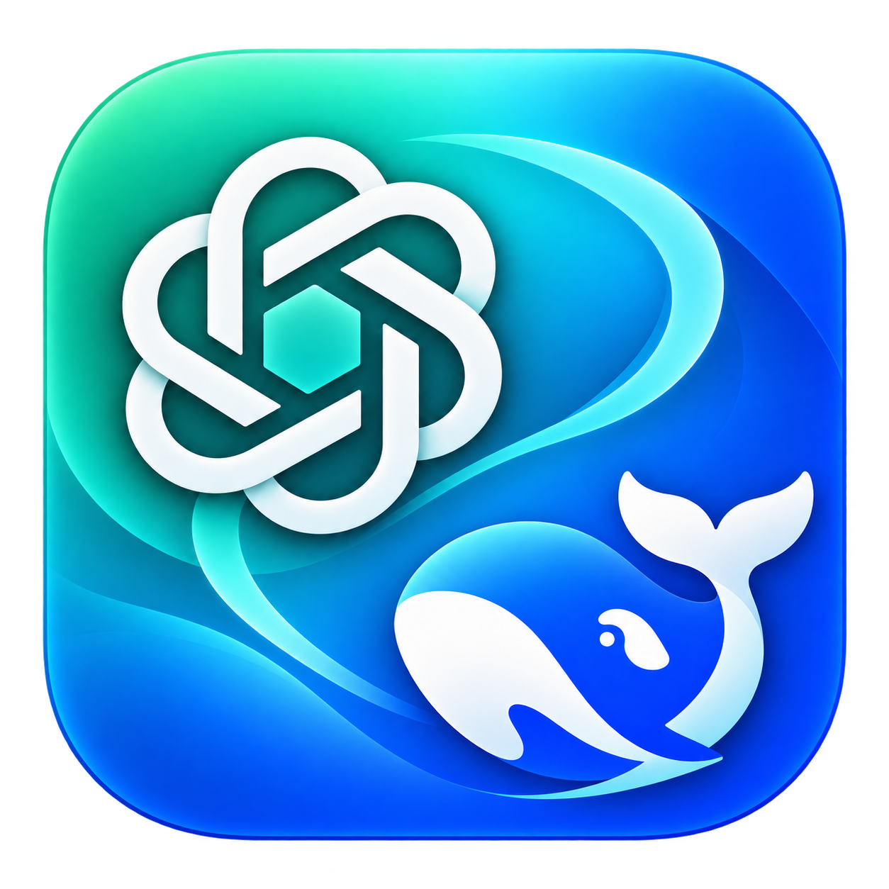

# Codex 模型切换器

更新授权说明：本机 1.6.3 使用固定本地签名，更新时会校验同一身份并保留授权记录，减少版本更新后再次授权。见 [更新授权与一次性设置](docs/signing.md)。



一个 macOS 本地工具，把 Codex 的模型、服务商和旧会话路由一起切换。
从 GPT 换到 DeepSeek，再换回来，以前的会话还能找到；切换前自动备份，旧备份按数量和时间清理。

起因是一次实际遇到的问题：已经登录 ChatGPT，也在菜单里选了 GPT，旧会话的请求却仍然发给 DeepSeek。
只改全局配置不够；只改数据库也不够，Codex 重新扫描聊天文件时又会把服务商改回去。
这个工具把两处一起处理。切到 GPT 时会自动修复已知的 DeepSeek 推理格式问题，无法自动处理时仍可使用「兼容接续」。

## 能力

- **GPT / DeepSeek 双向切换**：同时设置服务商、模型、推理强度和本地会话路由，避免把 GPT 模型名发给 DeepSeek 接口。
- **原会话保留**：不删除对话，不自动取消归档。原 ID、名称、项目、消息正文和归档状态保留。
- **切到 GPT 自动修复**：把已经验证且与历史备注逐字匹配的 DeepSeek 推理回放项转为历史展示记录，保持行号和字节偏移。未知格式会话跳过，并保留其原文件和路由。
- **全部历史入口**：在一个列表里查看不同服务商的会话，也能查已归档记录，支持按标题或 ID 搜索。
- **兼容接续**：旧推理记录不被目标模型接受时，提取用户和助手的可见文本，建立关联会话。原对话留着，新会话接着聊。
- **先备份再改**：保存配置、会话文件、状态数据库和分页历史数据库；相同内容去重保存。
- **文件权限检查与申请**：启动和操作前实测配置、数据库、历史和备份的访问权限。检查失败时显示具体路径、暂停写入，提供系统目录授权与权限设置入口。
- **待处理会话与只读诊断**：异常原因按类型汇总并默认折叠，可展开逐条忽略或恢复；按会话检查最近错误，区分格式、额度、网络、登录和权限，不发送模型请求。
- **最近 30 天切换范围**：默认只迁移最近 30 天活跃的会话，更早历史保留原服务商和文件；会话页显示活动时间。
- **复用已有接续**：失败后恢复同一关联，不重复新建或注入历史；区分未验证与验证成功，运行中不重复发送。
- **自动清理备份**：默认最近 10 份、最长 30 天，始终保留最近 3 份成功备份。数量、天数和开关都能改。
- **恢复不吞新消息**：回退模型和服务商设置，保留恢复点之后新增的会话、消息；中途失败留有恢复入口。
- **密钥进钥匙串**：DeepSeek key 存入 macOS 钥匙串，配置文件保留一份供 Codex 读取；备份里的密钥会脱敏。
- **只修复不切换**：Codex 重新扫描导致路由错位时，按当前模型重新对齐会话文件和数据库，不改变模型。
- **切回 DeepSeek 自动还原**：切到 DeepSeek 时把之前修复过的推理区段还原成原始记录，保留后来追加的消息。
- **单独修复 DeepSeek 历史**：保持当前模型，还原本工具保存的原始推理并对齐路由；冲突会话跳过，未知损坏不强行修复。
- **DeepSeek 官方联网开关**：Pro 可开启，Flash 显示不支持；两家模型分别保存偏好，开启前备份并检查模型目录声明。
- **当前配置状态**：手动轻量刷新服务商、模型、联网配置和客户端进程状态，显示最近检查时间，左上角图标跟随读取到的当前配置。
- **ChatGPT 登录保留**：DeepSeek 用自己的 API key，不拿它覆盖 ChatGPT 的登录凭据。

## 安装

1  从 [Releases 页面](https://github.com/reF0o0/codex-model-switcher/releases)下载当前版本的 `Codex-Model-Switcher-v1.6.3.zip`（或最新 Release 中的 zip）。

2  解压，把「Codex 模型切换器.app」拖到「应用程序」文件夹，双击打开。

3  确认本机已有 Python 3.11 或以上，以及通过 ChatGPT 账号登录的 Codex。
   这一版面向已经配置过 GPT / DeepSeek 的本地环境：DeepSeek 还需要已有的服务商定义和 `~/.codex/models.json` 自定义模型目录。
   API key 在工具的「DeepSeek 密钥设置」里填写或更换；保存密钥也要先按 ⌘Q 退出 ChatGPT（见下方排查）。

目前提供 Apple Silicon 构建。Release 使用本机固定证书签名，尚未做 Apple 开发者签名和公证；Release 同时提供 SHA-256 校验文件。

本机 1.6.3 使用固定本地证书签名，后续构建和安装沿用同一身份，减少更新后重新授权的问题；此证书只用于本人的这台 Mac，不作为公开分发方案。具体规则见 [更新授权与签名](docs/signing.md)。其他 Mac 首次打开时可能需要在“隐私与安全性”中手动允许。

## 使用

### 把以前的会话切到 GPT

1  先保存正在进行的工作，在 ChatGPT / Codex 按 **⌘Q 完全退出**。只关窗口不算退出；终端里的 Codex 和后台任务也要结束。

2  打开切换器，选择 GPT、账号可用的模型和推理强度。例如 `gpt-6.1-sol` / High。

3  点击「备份并切换最近 30 天」。工具只迁移近期活跃会话，并自动扫描、备份和修复已知问题。更早会话保持原状；完成后展开「处理明细」查看修复数量、跳过原因和备份 ID，再点「打开 ChatGPT」。

4  到原列表继续找会话，或在切换器的「全部历史」中搜索。原来归档的会话仍在归档里。

工具检测到 ChatGPT 或 Codex 进程正在运行时，会禁用切换、备份、恢复和新建接续，避免一边聊天一边改记录。退出客户端后，手动点「刷新」或「刷新状态」重新检查。

### 「保存密钥」是灰的，或提示密钥格式无效

- **按钮是灰的**：ChatGPT / Codex 还在运行，保存密钥同样需要先按 ⌘Q 完全退出，再点工具里的「刷新」。工具不会边运行边写 `config.toml`，否则 ChatGPT 退出时会用旧配置覆盖这次写入。
- **提示「API key 格式无效」**：DeepSeek 密钥形如 `sk-` 加 32 位字符，共 35 位。工具会自动去掉首尾空白、内部空格换行、不可见字符和 `Bearer ` 前缀，并把全角标点归一化（例如 `sk－` 变成 `sk-`）；粘贴带字段名或多行的整段文字时，会挑出 `sk-...` 那一段。仍然失败时，报错会直接说明是空输入、太短、太长，还是含有不允许的字符（附 Unicode 编码）。
- **提示「无法确认 ChatGPT 是否已退出」**：系统拒绝了进程查询。确认已退出后重试即可，工具宁可不写也不会冒险覆盖配置。

### 提示文件访问检查未通过

1. 在窗口上方“文件访问权限”展开明细，查看无法访问的路径。
2. 点“申请目录访问…”，在 macOS 窗口选择 `.codex` 目录或其上级目录，再点“允许访问”。隐藏文件已显示，目录默认定位到 `~/.codex`。
3. 软件自动重新检查。若之前在系统弹窗点过拒绝，点“系统权限设置”，在“隐私与安全性 → 文件与文件夹”允许切换器访问相关目录，再回来点“检查权限”。系统要求时退出并重开切换器。某些环境需要在“完全磁盘访问权限”中手动添加应用。

系统授权必须由本人确认，软件不能自行开启系统权限。选择目录后仍以实际读写检查为准。检查不修改现有配置、会话或数据库；在目标目录创建私有临时文件，验证写入、重命名和清理能力。只读磁盘、空间不足、路径缺失或符号链接也会说明原因，不能靠系统隐私授权修复这些问题。

权限检查不改变模型，也不要求先退出 ChatGPT；切换和修复仍需先退出。命令行可运行 `python3 -B src/cli.py permissions`，该入口在无法初始化备份目录时仍能返回检查报告。

### 只修复路由

如果 Codex 重新扫描后，旧会话又出现「配置是 GPT、请求却发给 DeepSeek」的错位，不用重新选模型。退出 ChatGPT，打开切换器的「切换模型」页，点「只修复路由，不切换模型」。它会先备份，再按当前 `config.toml` 里的服务商、模型和推理强度重新对齐所有 GPT／DeepSeek 会话的文件头和数据库路由。模型本身不变。

### 旧会话打开了，但还是不能回复

这跟「会话找不到」是两件事。实测中，GPT 会拒绝部分旧 DeepSeek 推理记录的 `content` 格式；路由改对以后，历史数据本身仍可能不兼容。

1.2.0 起，切到 GPT 时会自动修复已验证的格式。已经切换过的会话，可以退出 ChatGPT，在「全部历史」找到原会话点击「修复格式」，也可以在切换页点「检查并修复当前模型历史」。该按钮按当前配置自动区分 GPT 和 DeepSeek，修复本身只操作本地文件，不消耗模型额度。

修复要求推理项与已有的历史展示记录逐字匹配。未知格式会话会被跳过，原文件和路由保留；缺少本机文件的会话会列为未检查。查看「处理明细」区分这些结果，不代表所有会话都已通过模型请求验证。

仍无法自动修复时，可以在「全部历史」点「兼容接续」。工具会：

1. 保留原会话及其完整记录。
2. 提取用户和助手的可见文本，排除旧厂商推理记录和工具调用数据。
3. 优先恢复已有接续；没有关联时，创建带「GPT接续」或「DeepSeek接续」名称的新会话并立即保存关联。
4. 用当前模型确认接续完成，然后打开新会话。

后面在关联会话继续聊。「原会话」和「打开接续」两个入口都保留。

**兼容接续会使用一次所选模型的额度。** 超长对话自动带入最近 80,000 字符，全文另存到本机，路径提供给新会话。图片、附件和工具记录继续留在原会话，不自动重传；这一步不能把所有内部状态原样搬到另一家模型。

失败后使用“重试接续”，不会重复新建会话或注入文本；同模型已完成的验证不重复调用模型。切换模型需要重新验证。注入应答丢失时保留接续并停止，请手动查看，避免重复写入。恢复失败不会自动覆盖关联。

窗口使用“切换模型 / 会话 / 备份 / 文件权限”四个顶部入口。最近切换的待处理记录在会话页按原因分组折叠，可逐条诊断、忽略或恢复；会话列表独立滚动并显示活动时间。诊断读取最近五轮本地运行记录和已知 GPT 格式信息，无需退出 ChatGPT，不消耗模型额度。

### 再切回 DeepSeek

同样先退出 ChatGPT，选择 DeepSeek 和 `deepseek-flash` 或 `deepseek-v4-pro`，查看下方待还原数量，点「备份、还原并切到 DeepSeek」。即使当前已经是 DeepSeek，也可以再次执行以还原旧记录。

切回 DeepSeek 时，工具会按会话 ID 找到当前文件，按区段合并多批修复备份并还原原始推理记录。归档或移动后仍可定位；找不到文件或无法唯一确认时保留备份。修复位置被其他操作改过时会跳过整个会话并列出原因。仍需要的原始备份会被自动清理保护，还原后不再需要时才允许清理。

切换动作本身只处理本地文件，不调用模型。实际发起聊天或兼容接续时，GPT 使用 ChatGPT 登录对应的额度，DeepSeek 使用自己的 API 余额。工具不经过额外中转。

### 单独检查 DeepSeek 历史

已经使用 DeepSeek 时，退出 ChatGPT/Codex，刷新状态后在切换页点「检查并修复当前模型历史」；也可以在「全部历史」对单个会话点「还原推理」。它会保留当前模型和推理强度，先备份，再还原本工具保存的推理区段并对齐路由。修复位置被编辑、同 ID 存在未受备份覆盖的副本时，保留整个会话的文件与路由，继续保护原始备份。

此入口不是任意损坏修复器：没有原始备份的推理、丢失的调用配对和未知格式无法凭空补出。缺少本机文件的会话明确列为未检查正文。

### DeepSeek 联网开关与状态检查

切换页显示当前模型的 DeepSeek 官方内置搜索状态。是否支持以本机 `models.json` 中当前模型的 `supports_search_tool` / `web_search_tool_type` 声明为准，不再写死 V4 Pro；`deepseek-flash` 声明支持时可直接开启。需要先退出 ChatGPT/Codex，按钮会先备份，并只修正当前模型的搜索声明。

此开关不控制 MCP、浏览器、Agent Reach 等外部联网工具。GPT 与 DeepSeek 的联网偏好分别保存，切换到 Flash 会暂停内置搜索，回到 Pro 后可恢复此前偏好；日常恢复也包含联网配置和本工具改动的搜索声明，不覆盖模型目录的其他改动。

状态仅在启动、操作完成或手动点「刷新／刷新状态」时读取，显示最近检查时间，不自动轮询。状态读取不发送搜索或模型请求，单独「刷新状态」也不扫描全部历史。它不是运行中会话的遥测：客户端启动参数、会话级设置可能覆盖磁盘配置，无法确认运行中的客户端是否已经载入；修改前须退出并刷新，保存后重新打开。读取失败时会提示值可能过期并暂停写入。存在活动 profile 覆盖时，先处理该配置档。

左上角图标表示当前配置里的服务商，不随尚未执行的目标选项改变。应用的 Dock/Finder 图标保持绿蓝立体版。

## 备份怎么清理

| 规则 | 默认值 |
|---|---|
| 保留数量 | 最近 10 份成功备份 |
| 保留时间 | 最长 30 天 |
| 最少保留 | 最近 3 份，即使已经超过 30 天 |
| 自动触发 | 打开工具时、成功备份后 |
| 手动入口 | 「备份与恢复」→「立即清理」 |

工具关闭后没有常驻进程，也不创建系统定时任务；下次打开时再处理过期备份。
清理只处理本工具专用目录里的有效自建备份，共享内容在最后一份引用它的快照被清理后才删除。
会话、手动导出的文本和其他备份目录不属于自动清理目标。

备份位置：

```text
~/.codex/provider-switcher/
├── backups/          备份清单与去重内容
├── continuations/    兼容接续的完整文本导出
├── links.json        原会话与接续会话的关联
├── bridge-state.json 接续创建阶段、模型与验证状态
├── last-switch.json  最近切换数量与待复查记录
└── settings.json     保留数量、天数和清理开关
```

备份包含聊天内容。新备份里的 `config.toml` 会把 DeepSeek token 替换成占位符；1.1.0 之前创建的旧备份仍可能含有明文密钥。目录仅当前本机用户可访问，但备份内容没有加密，不要上传到公开仓库。被自动清理的旧备份不能在工具里找回。

## 恢复

若 `config.toml` 缺失、格式损坏或无法按 UTF-8 读取，窗口会显示“配置应急恢复”，无需先成功加载正常状态。按 ⌘Q 退出 ChatGPT/Codex，点“重新检查”，选择含有效配置的备份并恢复；其他文件的权限检查仍须通过。工具会完整校验备份，再重建配置和恢复模型、路由，新增会话与消息仍保留。

现存损坏配置按原始字节保存在 `~/.codex/provider-switcher/config-recovery/`，目录仅本人可访问；这些原文件可能含明文密钥，供本机手动合并未备份的设置，不应上传。重建时不会写回备份中的脱敏占位密钥；DeepSeek 密钥可从钥匙串取回，其他缺失密钥需重新填写。没有有效备份时不会自动编造配置。应急产生的不含配置的安全快照留作人工灾难恢复，不列为可选配置恢复点，也不会挤掉至少三份有效配置备份。

退出 ChatGPT，在「备份与恢复」选择备份，点击「恢复选中备份」。工具先校验快照，再创建一份恢复前的安全备份。

日常恢复回退模型与路由；如果所选备份对应一次格式修复，也会恢复该次修复的原始区段，不会拿旧数据库覆盖整份历史，因此后来追加的消息与新增会话仍保留。若修复位置被其他操作编辑过，工具会停止恢复，避免覆盖改动。完整历史快照留作人工灾难恢复；ChatGPT 登录和无关配置不随模型恢复一起回退。

切换过程中被强行关闭或断电时，会留下未完成操作标记。先选择提示的备份恢复，再继续切换；恢复过程再次中断时，也会保留最初的恢复点。

1.3.1 起，修复和还原两个方向都有操作区段日志。切回 DeepSeek 途中失败，可以恢复到之前的 GPT 配置、路由和历史格式；恢复过程中新增的消息仍保留。1.2.0/1.3.0 已有的修复备份继续可用，但旧版在还原方向没有写入操作日志，本版无法补出当时未保存的日志。

## 环境要求

- Apple Silicon Mac。构建目标为 macOS 14 或以上，实测环境是 macOS 26.7.1。
- Python 3.11 或以上，无第三方 Python 依赖。应用会查找 Python.org 安装位置、Homebrew 和系统路径。
- ChatGPT / Codex 桌面应用。当前实测 Codex CLI 为 `0.162.0-alpha.17.2`。
- GPT 需要现有的 ChatGPT 登录及可用模型额度。
- DeepSeek 需要 API key、`model_providers.deepseek` 定义，以及包含 `deepseek-flash` / `deepseek-v4-pro` 的 `~/.codex/models.json`。

工具使用本地状态格式和实验性的 Codex app-server 接口。其他 Codex 版本不保证兼容；遇到不支持的数据格式会停止操作，先保留备份再排查。

## 从源码运行与构建

```bash
git clone https://github.com/reF0o0/codex-model-switcher.git
cd codex-model-switcher

# 后端测试：临时目录和模拟数据，不调用模型
python3 -B -m unittest discover -s tests -v

# 开发构建：ad-hoc 签名，不需要发布证书
zsh scripts/build.sh dev
open "dist/Codex 模型切换器-dev.app"

# 发布构建：需要本机固定签名身份
zsh scripts/build.sh release
open "dist/Codex 模型切换器.app"
```

构建产物在 `dist/`，包含 `.app` 和压缩包。后端也可以直接查看状态：

```bash
python3 -B src/cli.py status
```

数据库损坏时，窗口会显示“应急恢复”；选择含有效数据库的备份后点“从备份修复数据库”。该操作只替换损坏或缺失的数据库，原文件会保留在工具数据目录，备份之后新建的会话可能需要重新扫描。

## 仓库结构

```text
app/App.swift             SwiftUI 界面
src/cli.py                JSON 命令行入口
src/switcher/core.py      配置、路由迁移、恢复与兼容接续
src/switcher/backups.py   去重备份、校验和保留规则
src/switcher/compatibility.py  等长历史格式修复与区段恢复
src/switcher/rpc.py       本地 Codex app-server 通信
tests/test_switcher.py    文件、SQLite 和恢复边界测试
tests/test_compatibility.py  自动修复、未知格式跳过与中断恢复测试
tests/test_deepseek_controls.py  DeepSeek 单独修复、联网状态与恢复测试
scripts/build.sh         编译、签名和打包
docs/usage.md            详细使用说明
docs/verification.md     实测范围与验证记录
```

## 实测与已知限制

- 后端回归测试覆盖单会话只读诊断、接续复用、状态检查、文件权限与写入拦截、联网设置、异常中断与恢复，以及已有的路由、修复、备份和密钥功能；本版运行结果见 docs/verification.md。
- 1.4.1 的 Swift 应用模型在合成数据中验证了权限撤销后的切换拦截和重新检查恢复；原生界面连接故障，系统授权弹窗与鼠标点击尚未验收。
- 1.4.0 的 Swift 应用模型在独立数据下验证了两种图标、当前配置与目标选项区分、开关、外部编辑刷新、进程保护和读取失败恢复。原生界面自动化连接不可用，本版未完成鼠标点击与像素布局验收。
- 1.3.1 在真实记录副本上还原了 17 个文件、16 个会话 ID、1062 条记录，再撤销还原；文件内容逐字节核对一致，归档定位与追加消息保留均通过验证。
- 在真实记录的独立副本上批量修复了 17 个会话、1062 条推理记录，另有 5 个未知格式文件保持原样；所有未改动行的字节一致，重复检查无需再次修复。
- 单会话的 138 条推理记录经生产修复代码处理后，729 条可见历史核对一致，Codex 成功加载并完成实际 GPT 请求。
- 在独立数据副本上验证过 446 个会话、46,586 条分页历史消息；正常迁移前后消息散列、原 ID、标题和归档状态一致。
- 官方会话接口在重新扫描后仍能找到迁移后的会话；GPT 与 DeepSeek 的文本兼容接续都完成了真实请求。
- 同一个原会话直接切换后能否继续回复，取决于历史格式是否被目标模型接受。兼容接续用新的关联会话承接文本，不会把原会话删掉或冒充成无损转换。
- 当前只处理这台 Mac 的本地 Codex 记录，不修改 ChatGPT 云端聊天，也不负责跨设备同步。
- 首版需要已有的 DeepSeek 自定义模型目录，不包含从零配置所有服务商的安装向导。

详细过程见 [验证记录](docs/verification.md)，日常操作见 [使用说明](docs/usage.md)。仓库和 Release 不包含本机会话、备份、真实密钥或登录凭据。
